# PS3 Sentinel


PS3 Sentinel reads an SMS on the device and decides whether it is ham, unwanted promotion, or a scam or phishing attempt. It highlights the words that caused the verdict. For medium or high risk it asks Llama 3.2 1B on the device for plain-language advice. Nothing leaves the device: the manifest declares no `INTERNET` permission, so Android blocks all network access for the app, enforced by `test_no_network_permissions` in `tests/test_android_manifest_privacy.py`; phone packet capture was not done (no root).

## Quick start for judges

Release assets: [phase1-submission](https://github.com/Vishnu-3727/ps3-sentinel/releases/tag/phase1-submission)

The four deliverables:
1. **Source code**: this repository (`https://github.com/Vishnu-3727/ps3-sentinel`).
2. **Application**: signed release APK (`ps3-sentinel-1.0.apk`, 13.4 MB) and Python wheel (`ps3_sentinel-1.0.0-py3-none-any.whl`) in the GitHub release.
3. **Technical report**: [docs/engineering_report.md](docs/engineering_report.md).
4. **Demo video**: link to be added.

### Android steps
1. Download release assets into a local folder (e.g. `./release`):
   ```powershell
   gh release download phase1-submission --repo Vishnu-3727/ps3-sentinel --dir ./release
   ```
   Or download them via browser from the [release page](https://github.com/Vishnu-3727/ps3-sentinel/releases/tag/phase1-submission).
2. Connect your Android phone with adb enabled (ensure exactly one device is connected via `adb devices`).
3. Run the installer script:
   ```powershell
   # Windows PowerShell
   scripts/install_phone.ps1 -Folder ./release

   # Linux / macOS
   bash scripts/install_phone.sh ./release
   ```
   The script checks adb and the connected device, verifies asset integrity against `SHA256SUMS`, installs the APK with `adb install -r`, launches the app once to initialize storage, checks `/proc/cpuinfo` for `asimddp`, pushes models to `/sdcard/Android/data/org.ps3.sentinel/files/models/` (`sms_int8.pte` on phones with Arm dot product, or `sms_fp32.pte` on phones without), and reports total pushed size.
   Model storage on phone: 1,144 MB (about 1.14 GB) on phones with Arm dot product, 1,206 MB (about 1.21 GB) without. Both totals are measured pushes, listed file by file in `docs/research/2026-11-15_speed_size_audit.md`: Llama 1,083.3 MB + SMS 51.0 MB int8 (or 112.0 MB hybrid `sms_fp32.pte` on phones without dot product) + `sms_vocab.txt` 6.0 MB + Llama `tokenizer.model` 2.1 MB + URL 1.1 MB + `id_map.json` 1.0 MB. The app declares no `INTERNET` permission.

## Screenshots

| Loading | Onboarding | Home |
|---|---|---|
| 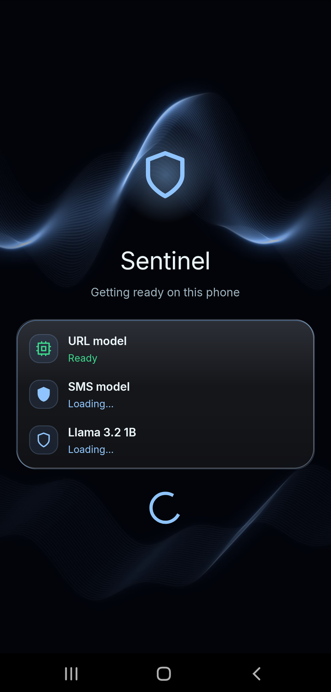 | 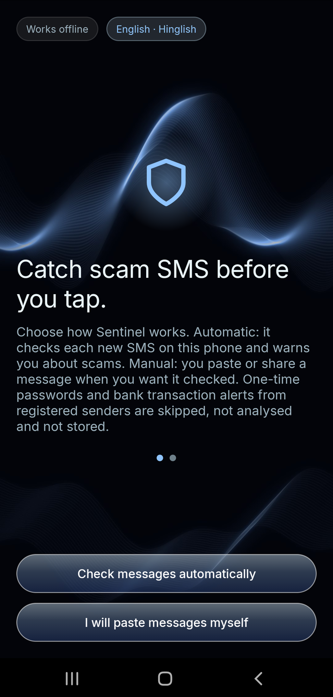 | 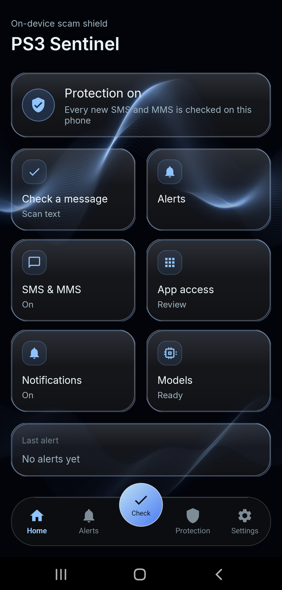 |
| Loading: the three models load on the phone before the first scan. | Onboarding: automatic checking of incoming SMS, or paste messages yourself. | Home: protection status, shortcuts to Check, Alerts, SMS and MMS, App access, Notifications and Models. |

| Check | Result: scam | Result: scam, advice |
|---|---|---|
| 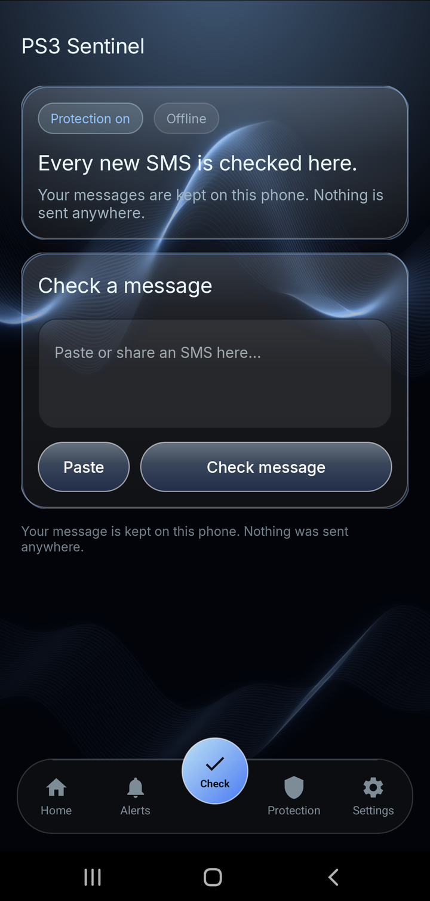 | 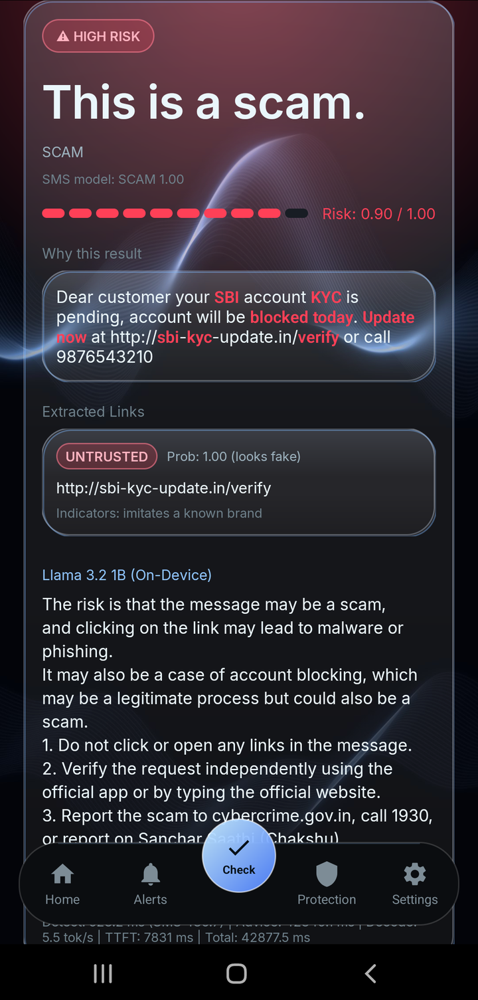 | 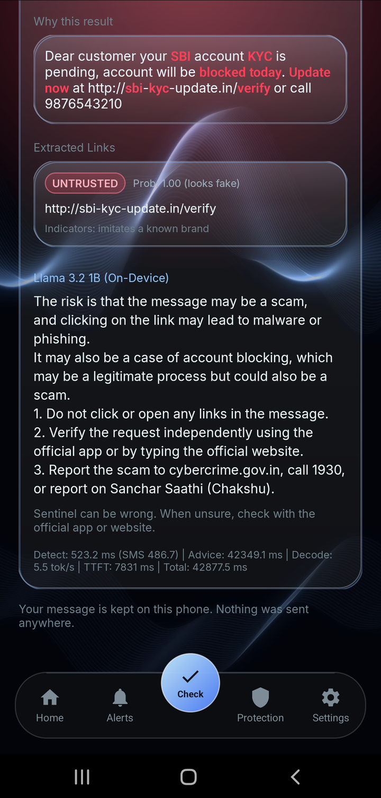 |
| Check: paste or share a message. | Result scam: risk meter, highlighted cues and link verdict. | Llama 3.2 1B advice on the phone, three safe steps and timings. |

| Result: safe | Result in Tamil | Result in Hindi |
|---|---|---|
| 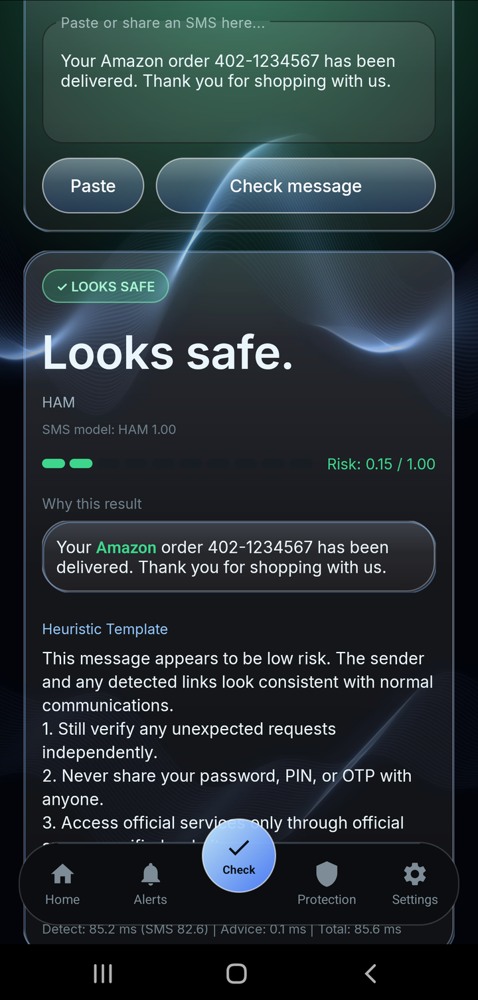 | 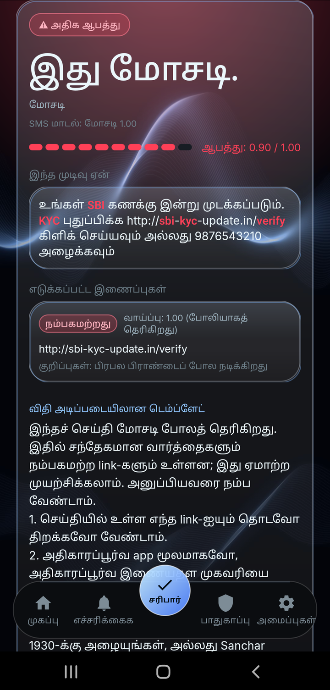 | 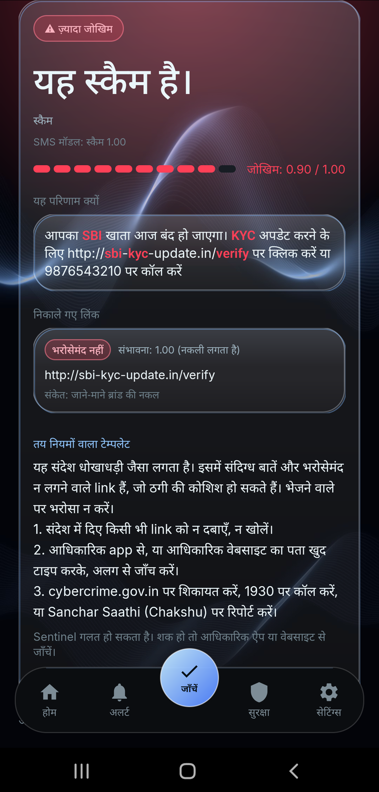 |
| Result safe: low risk, no alert, fixed safe-use tips. | Tamil: app text in Tamil, same verdict and risk as English, advice from the fixed Tamil template. | Hindi: app text in Hindi, same verdict and risk as English, advice from the fixed Hindi template. |

| Alerts | Protection | Settings |
|---|---|---|
| 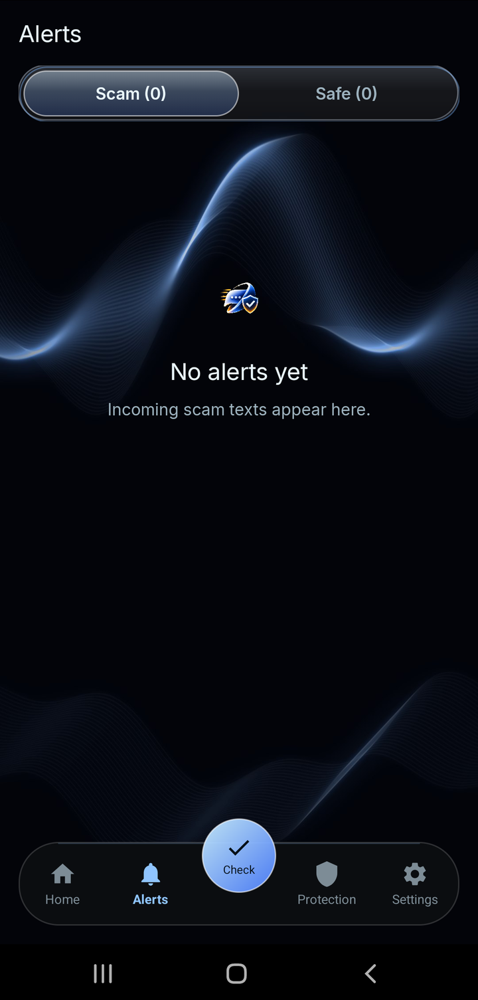 | 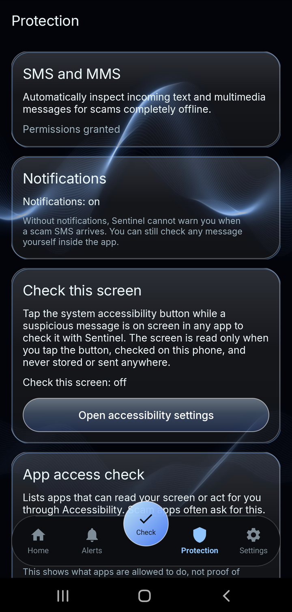 | 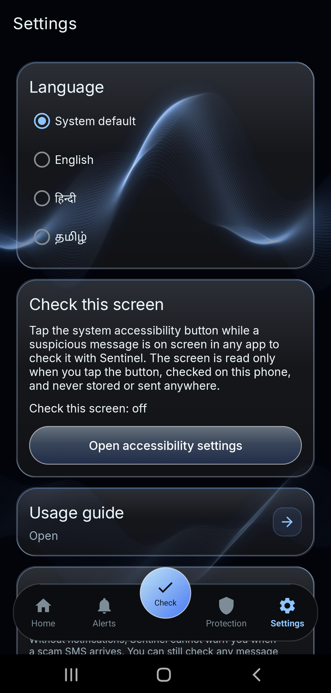 |
| Alerts: incoming messages that raised an alert, scam and safe lists. | Protection: SMS and MMS access, notifications, Check this screen, app access check. | Settings: app language (English, Hindi, Tamil), Check this screen, usage guide. |

Screenshots from the release build on a Galaxy M31 (LIGHT tier), 2026-11-24; status bar cropped. The 2026-11-22 Galaxy F14 set of the earlier UI is in `docs/screenshots/2026-11-22_f14/`.

## Features

- SMS classifier: MiniLM-L12 base model, which is multilingual, fine-tuned for 3 classes (ham, unwanted, scam), int8 ExecuTorch.
- URL classifier: character CNN over raw URLs, fp32 ExecuTorch.
- Language support: English and romanised Hinglish are supported (shipped-rule held-out F1 0.965 and 0.965); native Indian scripts are experimental (weak cells from the shipped-rule held-out table). Source: `bench/heldout/sim_script_gate_20261110.json`, replayed 2026-11-10.
- App languages: the app screens are in English, Hindi and Tamil. Pick the language in Settings (System default, English, हिन्दी, தமிழ்) or in Android per-app language settings. Llama advice is written in English; in Hindi or Tamil the app shows a fixed Hindi or Tamil advice template instead.
- Cue rules: regex rules for urgency, threat, KYC, OTP/PIN, UPI collect, APK install, and Hinglish phrases.
- Fusion: one risk score 0..1, levels low (<0.4), medium (<0.7), high (>=0.7), cue spans and per-link verdicts.
- Llama 3.2 1B Instruct advisor: called only for medium or high risk, with an advice guard.
- Android app: incoming-SMS alerts, share-to-app, "Check with Sentinel" in the text-selection menu, paste input, highlighted cues, streamed advice.
- Sender-aware alerts: a registered business sender (DLT header) is notified only on a scam verdict from the SMS model or a high-risk rule; its links alone do not raise an alert. Real-inbox alert rate fell from 27-53 percent to about 3 percent on three phones with held-out recall unchanged. Source: `docs/benchmarks.md`, section "Real-inbox alert rate and the registered-sender rule".
- Plain promotions (medium and unwanted, no link, no number, no reply request) are shown as "Looks like a promotion" with fixed advice and no Llama call.
- App access check: checks installed apps with Accessibility screen-reading or gesture capabilities and SMS access in Settings.
- Check this screen accessibility feature: off by default, reads the active window only when the user taps the accessibility button, nothing stored or sent (core SMS protection works completely without it; see `docs/privacy_proof.md`).
- Alert list privacy: the app now keeps the text of analysed incoming messages (scam and safe, at most 50 each), encrypted with an Android Keystore key, deletable with Clear all or by uninstalling; OTP and routine bank alerts are never stored.

## How it works

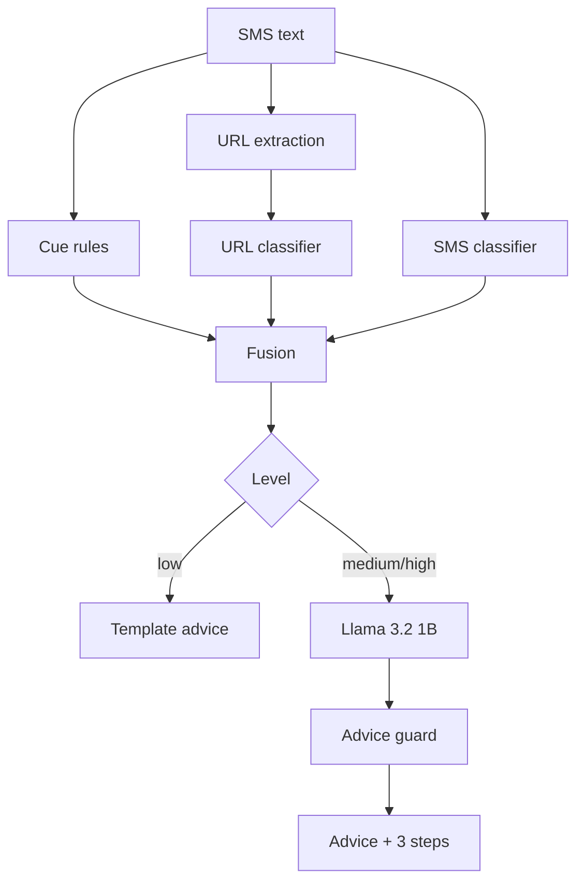

- SMS classifier. MiniLM-L12 base model (multilingual), fine-tuned for 3 classes. int8 ExecuTorch. Source: `docs/engineering_report.md`, `docs/benchmarks.md`.
- URL classifier. Character-level CNN, 284k parameters, over the raw URL. fp32. Source: `docs/engineering_report.md`.
- Cue rules. Regex rules shared via `sentinel/data/rules.json` between Python and Kotlin. Pinned by parity tests. Source: `docs/engineering_report.md`.
- Fusion. SMS score = `0.9 x temperature-scaled P(scam) + 0.5 x temperature-scaled P(unwanted)` with `sms_temperature = 3.0` (`sentinel/data/rules.json`, `sentinel/fusion.py _sms_components()`); URL score = 0.9 x max over untrusted links, capped at 0.2 on trusted domains. Cue score = 0.15 per cue type, capped at 0.6, with named combo floors. Risk = max of the scores. Source: `docs/engineering_report.md`.
- Llama advice and guard. Llama gets the message plus a compact evidence line. The guard hedges certainty words, drops click/call sentences, drops restated threats, replaces refusals and contradictions with the template, and appends the three safe steps when none are present. Source: `docs/engineering_report.md`, `docs/benchmarks.md`.

## Device support


| Phone | CPU features detected (`docs/arm_story.md`, `docs/device_tests/*.md`) | Best kernel path |
|---|---|---|
| Galaxy M31 | `fp asimd evtstrm aes pmull sha1 sha2 crc32 cpuid`, i.e. Armv8.0: no atomics, no dot product, no fp16 | `NEON` |
| Galaxy F12 | atomics present, `fphp` present, **not** `asimddp` | `NEON` |
| moto g73 5G | atomics and `asimddp` present | `DOTPROD` |
| Galaxy M32 | atomics and `asimddp` present | `DOTPROD` |
| Galaxy F14 5G | atomics, `asimddp` and `fphp` present | `DOTPROD` |

Kernels compiled into the Armv8.0 AAR (`docs/arm_story.md`, measured from unstripped `libexecutorch_jni.so` built by `deploy/android/build_executorch_aar.sh`): Plain NEON 163, dot product 50 plus 12 with fp16, fp16 arithmetic 91, i8mm 25, SME 31, SME2 71, SVE 0. None of the five tested phones reports `i8mm`, `sve`, `sve2`, `sme`, `sme2` or `bf16`, so `SME2` and `I8MM` are not selected on any tested phone and any SME2/i8mm gain is unmeasured (`docs/arm_story.md`).

What works, with one representative warm value or range per cell. Detect is SMS detection per message, TTFT is Llama time to first token.

| Phone | SoC | Kernel path | SMS detect, first to last message (ms) | Llama TTFT (ms) | Decode (tok/s) | Memory PSS |
|---|---|---|---|---|---|---|
| moto g73 5G | Dimensity 930 | `DOTPROD` | 13.1-73.0 | 1018-1635 | 9.8-10.2 | 1489378 kB |
| Galaxy F12 | Exynos 850 | `NEON` | 2829-10443 | 8687-12637 | 3.8-4.0 | 1404016 kB |
| Galaxy M31 | Exynos 9611 | `NEON` | 382-5588 | 4440-7572 | 5.3-5.7 | 1594810 kB |
| Galaxy M32 | Helio G80 | `DOTPROD` | 25.4-1032.6 | 2102-3377 | 5.5-6.3 | 1436089 kB |
| Galaxy F14 5G | Exynos 1330 | `DOTPROD` | 15-761 | 1197-1961 | 7.6-9.2 | 1442746 kB |

The highest value in each range is the first message after launch.

All raw values are in `docs/device_tests/`.

- Open problems (`docs/device_tests/PROBLEMS.md`, not edited here): DT-2 keeps the promotion case at MEDIUM by decision; LOW needs new real Indian promotional SMS. DT-18 residual accepted (a message arriving 5 to 10 s after advice, or right after launch, waits for a running re-prefill on the Galaxy M31). Galaxy F12 re-tests are pending for DT-5, DT-6 and DT-8. See `docs/device_tests/PROBLEMS.md`.

## Benchmarks and detection quality

Held-out results (detection only, no Llama). Source: `docs/benchmarks.md` and the evaluation files under `bench/heldout/`.

- SMS v5 ship model, 62,176 messages, template-grouped split: macro F1 0.977, risky FPR 0.87 percent, ROC-AUC 0.999.
- Indian-real subset, 631 messages: macro F1 0.870, FPR 5.1 percent, scam recall 0.90.
- URL v2, 658k URLs: precision 0.975, recall 0.741, F1 0.842, FPR 0.81 percent.
- Held-out evaluation with the shipped fusion rules, 13,098 rows: F1 0.817, recall 0.766, FPR 10.9 percent. English F1 0.965, Hinglish F1 0.965, Tamil recall 0.945, Hindi recall 0.968. Weakest recall cell is Kannada 0.300; weakest FPR cell is Telugu ham FPR 39.2 percent. One source is synthetic. Source: `bench/heldout/sim_script_gate_20261110.json`. The 2026-11-07 pre-calibration table (F1 0.807, recall 0.772, FPR 14.0 percent) is kept in `docs/benchmarks.md`.
- Shipped model `sms_v6ml` with the shipped rules, same held-out English and Hinglish rows, incoming-SMS path, 2026-11-15: English recall 89.8 percent, false alarms 0.0 percent, F1 0.946; Hinglish recall 85.0 percent, false alarms 0.2 percent, F1 0.918. The 0.965 figures above are the earlier v5 model. Source: `bench/results/alert_rate_registered_sender_20261115.json`.
- Real inboxes (three phones, 4,785 business SMS templates, unlabelled): alerts on 3.1 to 3.7 percent after the registered-sender rule, 26.7 to 52.8 percent before it.

Full tables and caveats: `docs/benchmarks.md`.

## Privacy and security

The Android app declares no network permission. Privacy evidence and its limits are documented in [docs/privacy_proof.md](docs/privacy_proof.md); security-sensitive behavior is covered by the tests under `tests/` and `android/app/src/test/`.

## Repository layout

- `android/`: Kotlin app, Gradle build, ExecuTorch AAR wiring, unit tests.
- `bench/`: latency and Llama benchmarks, result folders, held-out evaluation.
- `data/`: dataset catalogue processing, source map, processed and raw inputs.
- `docs/`: reports, benchmarks, audits, design spec, datasets, demo script, screenshots (`docs/screenshots`).
- `models/`: local model files. Not in git. See Build and run.
- `scripts/`: one-command checks (`scripts/check.ps1`, `scripts/check.sh`).
- `sentinel/`: Python pipeline: detectors, fusion, advisor, CLI, shared rules data.
- `tests/`: Python tests and parity fixtures.
- `training/`: SMS and URL training and export scripts.

## Build and run

### Python

```powershell
python -m pytest -q
python -m sentinel scan "<message text>"
python -m sentinel scan --file messages.txt
```

Checks: `scripts/check.ps1` runs the Python tests, Android unit tests when a JDK is present, module-boundary greps, `bash -n` on shell scripts, and a PowerShell parse pass over `deploy/` and `scripts/`. It ends with `PASS: all checks passed`.


### Android

```powershell
cd android
./gradlew assembleDebug
deploy/android/full_test.ps1 -Serial <serial>
```

The APK package is `org.ps3.sentinel`. Debug builds use the Armv8.0 ExecuTorch 1.5.1 build (`android/app/libs/executorch-android-1.5.1-armv8.aar`, built by `deploy/android/build_executorch_aar.sh` with `-march=armv8-a -moutline-atomics` since commit a738ab9; see `docs/build_executorch_armv8.md`), which has no Armv8.2/LSE requirement and was measured working on the Armv8.0 Galaxy M31 (`docs/device_tests/galaxy_m31_20261108.md`, re-test section: no SIGILL, all models load, Llama 5.3-5.7 tok/s). History: the stock Maven AAR (`org.pytorch:executorch-android:1.5.1`) contains inline Armv8.1 LSE atomics and crashed with SIGILL on Armv8.0 (`docs/build_executorch_armv8.md`); `android/app/build.gradle.kts` still falls back to that Maven artifact when the local Armv8.0 AAR is absent.

Package submission release assets with `python scripts/package_submission.py --models-dir <folder with the release model files>` (or repeated `--model-file`). The packaging script also builds the Python wheel, hashes all release artifacts into `SHA256SUMS`, and refuses to run on a dirty git tree unless `--allow-dirty` is passed.

## Reports index

- `docs/phase1_betterment.md`: improvements across detectors, pipeline, advice, and UI.
- `docs/engineering_report.md`: system design, models, Android compatibility, and limits.
- `docs/benchmarks.md`: held-out quality and Android device results.
- `docs/arm_story.md`: Android Arm support and tested CPU paths.
- `docs/research/2026-11-06_standout_upgrades.md` and `2026-11-06_engineering_standards.md`: upgrade and engineering notes.
- `docs/design/ui_redesign_2026-11-07.md`: UI design specification.
- `docs/hardware_test_plan.md`: Android device test steps and evidence collection.
- `docs/datasets.md`: dataset catalogue, label mapping, and licences.
- `docs/requirements.md`: functional and non-functional requirements.
- `docs/privacy_proof.md`: privacy evidence and limits.
- `docs/demo_script.md`: demo video shot list.
- `docs/ps3_transcript.md`, `docs/ps3_video_notes.md`, and `docs/recon/competitors.md`: challenge and competitor notes.
## Known limits and next steps

- On a slow phone a message that arrives in the first half minute after the app process starts is first judged by rules only and analysed again when the SMS model is free; a genuine business message with a brand link can show a short-lived alert in that window.
- Tamil and Hindi app text and advice templates are in place, but Llama advice is English only, the Tamil and Hindi detection figures come from synthetic messages, and the Hindi and Tamil strings still need a native-speaker review.
- On the Galaxy F12 (no dot product, 4 GB) a message checked while Llama is still warming up after launch waits up to 10 s for the SMS model and then falls back; the verdict stays correct. The URL model scored the test phishing link 0.85 on the F12 against 1.00 on dot-product phones (same model file). Source: `docs/device_tests/release_check_20261122.md`.
- A scam sent from a registered DLT header is notified only when the SMS model calls it a scam or a high-risk rule fires. Worst case (every held-out scam sent from a header): English recall 84.4 percent, Hinglish 78.8 percent. Source: `docs/benchmarks.md`.
- Opening a stored alert re-analyses the text without the sender, so the in-app level can be higher than the level that decided the notification.
- Phone cold open to first advice token is 9.74 s mean on battery. SMS warm-up and the lazy Llama weights load dominate. Source: `bench/results/f14_cold_open_after_tokenizer_20261107/summary.txt`, 2026-11-07.
- Indian-real false-positive rate is 5.1 percent as of 2026-11-06. The Punjab fraud source scored F1 0.376 when held out. Native-script languages are weak on the shipped-rule held-out set (Kannada recall 0.300, Telugu ham FPR 39.2 percent). 200+ hand-labelled Indian test SMS are still to be collected. URL recall is 0.741. Source: `docs/benchmarks.md`, `bench/heldout/sim_script_gate_20261110.json`.
- Llama: re-export from official Meta weights once access is granted. Indian-language advice is planned. Source: `docs/engineering_report.md`.
- The fallback prompt uses a temporary file; latency corpora overlap some training sources and must not be used for accuracy claims. See `docs/privacy_proof.md` and `docs/benchmarks.md`.

## About and licences

PS3 Sentinel code is licensed under Apache-2.0 (see [LICENSE](LICENSE)). Third-party components, model weights, fonts, and datasets keep their respective licences. See [NOTICE](NOTICE) for full attribution, Llama 3.2 Community License details ("Built with Llama"), Acceptable Use Policy links, MiniLM base model attribution, font licences, and dataset terms.
